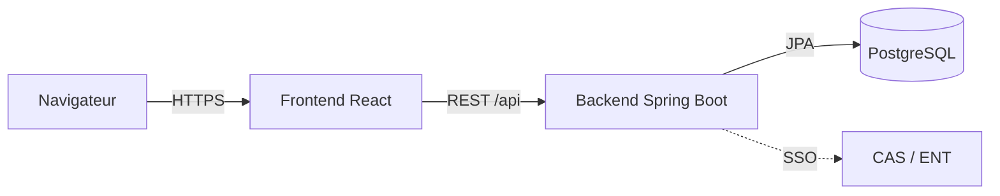

<div align="center">

# Evalio

**Consulte tes notes simplement, clairement, en un coup d'œil.**

Plateforme web de consultation des notes pour les étudiants du BUT Informatique — IUT Montpellier-Sète.

<!-- Activité du dépôt -->


<!-- CI -->
[](https://github.com/v3nel/evalio/actions/workflows/backend.yml)
[](https://github.com/v3nel/evalio/actions/workflows/frontend.yml)

<!-- Stack -->


</div>

---

> [!NOTE]
> Projet étudiant **non officiel**, développé par un étudiant délégué de promo. Evalio n'est pas un service de l'Université de Montpellier.

## Sommaire

- [Fonctionnalités](#fonctionnalités)
- [Stack technique](#stack-technique)
- [Architecture du monorepo](#architecture-du-monorepo)
- [Démarrage rapide](#démarrage-rapide)
- [Scripts utiles](#scripts-utiles)
- [Tests](#tests)
- [CI/CD](#cicd)
- [Données personnelles (RGPD)](#données-personnelles-rgpd)
- [Feuille de route](#feuille-de-route)
- [Contribuer](#contribuer)
- [Licence](#licence)

## Fonctionnalités

- 📊 **Consultation des notes** par semestre, UE et ressource
- 🧮 **Moyennes calculées** automatiquement avec les coefficients (jamais stockées)
- 📈 **Graphiques de progression**
- 🏷️ Gestion des statuts **ABS / ABJ / DISP**
- 👩‍🏫 **Espace enseignant** : saisie, import et publication des évaluations
- 🕓 **Historique** des modifications de notes
- 🔐 **Authentification** via l'ENT (CAS), si l'IUT l'autorise
- 🛡️ **Journal d'accès** et gestion du consentement (RGPD)

## Stack technique

| Couche | Technologies |
| --- | --- |
| **Backend** | Java 25, Spring Boot 4.2 (Web, Data JPA, Security, Validation, Actuator), Flyway |
| **Base de données** | PostgreSQL (Docker en local) |
| **Frontend** | React, Vite, TypeScript, React Router, TanStack Query, Tailwind CSS, shadcn/ui, Recharts |
| **Qualité** | JUnit 5, Testcontainers, ESLint, Vitest |
| **CI/CD** | GitHub Actions (workflows filtrés par `paths`) |

## Architecture du monorepo

```text
evalio/
├── backend/                 # API REST Spring Boot
│   ├── src/main/java/...    # organisation par feature (note/, evaluation/, auth/…)
│   ├── src/main/resources/
│   │   ├── application.yml
│   │   └── db/migration/    # migrations Flyway (V1__init.sql, …)
│   └── src/test/
├── frontend/                # SPA React + Vite
│   └── src/
│       ├── features/
│       ├── components/
│       └── lib/
├── docs/                    # cahier des charges, schéma BDD, maquettes
├── compose.yaml             # PostgreSQL local
└── .github/workflows/       # backend.yml, frontend.yml
```



## Démarrage rapide

### Prérequis

- JDK 25
- Bun (ou Node.js LTS)
- Docker Desktop

### 1. Cloner

```bash
git clone https://github.com/v3nel/evalio.git
cd evalio
```

### 2. Base de données

```bash
cp .env.example .env   # puis renseigner les variables
docker compose up -d
```

### 3. Backend

```bash
cd backend
./mvnw spring-boot:run      # ou ./gradlew bootRun
```

L'API écoute sur `http://localhost:8080`. Pour vérifier qu'elle tourne : `http://localhost:8080/actuator/health`.

### 4. Frontend

```bash
cd frontend
npm install          # ou bun install
npm run dev
```

L'application est disponible sur `http://localhost:5173`. Par défaut elle utilise des **données mock** (maquettes Figma, sans backend). Pour interroger l'API Spring :

```bash
VITE_USE_MOCK=false npm run dev
```

Le proxy Vite envoie `/api` vers `http://localhost:8080`. Détail des routes, du client typé et des contrats API : [`frontend/README.md`](frontend/README.md).

## Scripts utiles

| Commande | Rôle |
| --- | --- |
| `docker compose up -d` | Lance PostgreSQL |
| `./mvnw spring-boot:run` | Lance l'API |
| `./mvnw verify` | Tests backend (dont Testcontainers) |
| `npm run dev` / `bun run dev` | Serveur de dev du frontend |
| `npm run build` / `bun run build` | Build de production du frontend |
| `npm run lint` / `bun run lint` | ESLint |

## Tests

- **Backend** : tests de tranches (`@WebMvcTest`, `@DataJpaTest`) et tests d'intégration sur un vrai PostgreSQL avec Testcontainers.
- **Frontend** : Vitest et Testing Library.

## CI/CD

Il y a deux workflows indépendants, déclenchés seulement quand leur dossier change :

- `backend.yml` : build, tests et analyse, sur `backend/**`
- `frontend.yml` : lint, typecheck, tests et build, sur `frontend/**`

## Données personnelles (RGPD)

Les notes sont des **données personnelles**. Le projet applique :

- la **minimisation** : seules les données nécessaires sont collectées ;
- un **contrôle d'accès strict** : chaque étudiant ne voit que ses propres notes ;
- la **journalisation** des accès et l'**historique** des modifications ;
- une **durée de conservation** limitée et le respect des droits d'accès, de rectification et d'effacement.

La mise en production est conditionnée à l'accord de l'IUT, sur la source des données comme sur l'authentification CAS.

## Feuille de route

- [x] Choix de la stack
- [x] Modélisation de la base de données
- [ ] Validations auprès de l'IUT
- [ ] Setup du monorepo et de la CI
- [ ] Authentification
- [ ] Consultation des notes (MVP)
- [ ] Espace enseignant
- [ ] Déploiement

Le détail complet est dans [`docs/evalio-cahier-des-charges.md`](docs/evalio-cahier-des-charges.md).

## Contribuer

1. Crée une branche : `feat/ma-fonctionnalite`
2. Écris tes commits au format [Conventional Commits](https://www.conventionalcommits.org/fr/)
3. Ouvre une pull request vers `main`

## Licence

À définir.

---

<div align="center">
Fait avec ❤️ à Montpellier par <a href="https://github.com/v3nel">@v3nel</a>
</div>
